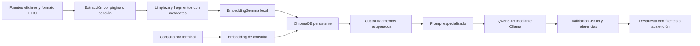

# Arquitectura hasta semana 9

Se usa distancia coseno; el índice persiste localmente y se reconstruye cuando cambian las fuentes. Qwen3 se configura con temperatura 0, contexto de 4096 y `think=false`; aun así, no se garantiza determinismo entre versiones o hardware. Se conserva separación entre recuperación y generación. Ollama escucha en localhost y no se expone como servicio público.

La API FastAPI, frontend React/Next.js, historial de sesión y despliegue quedan programados para semanas 10-12. El prototipo no consulta Smart Campus ni información privada de estudiantes.

Actualización de alcance: el público objetivo son todos los pregrados y modalidades del Politécnico Grancolombiano. La cobertura documental específica depende del programa. El corpus distingue programa, modalidad y plantilla; ETIC no es universal. Las evidencias anteriores de semanas 6–9 corresponden al piloto histórico restringido. La nueva ejecución se registra en evidencias/alcance_pregrados. Para consultar un programa puede usarse --programa y --modalidad. La cobertura específica presencial requiere fuentes propias; el chatbot se abstiene ante requisitos no documentados.
